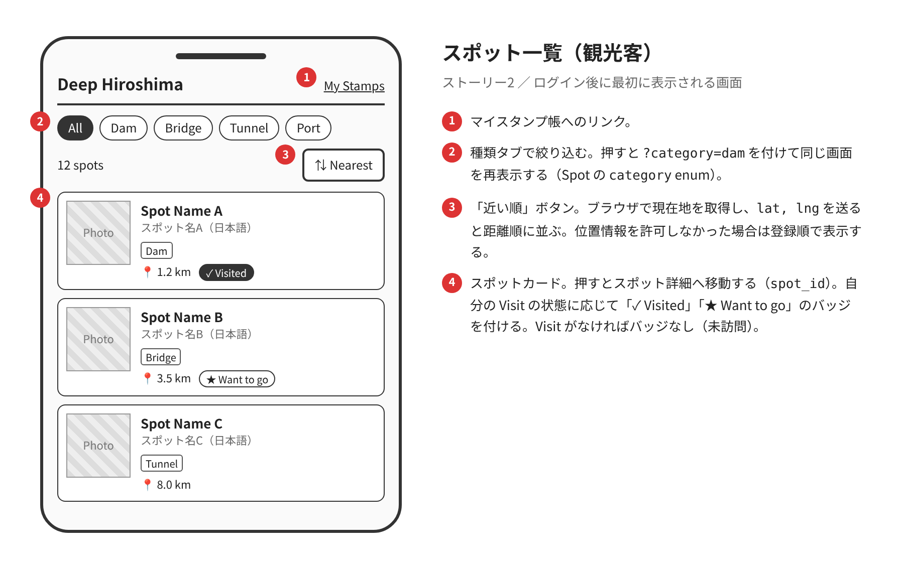
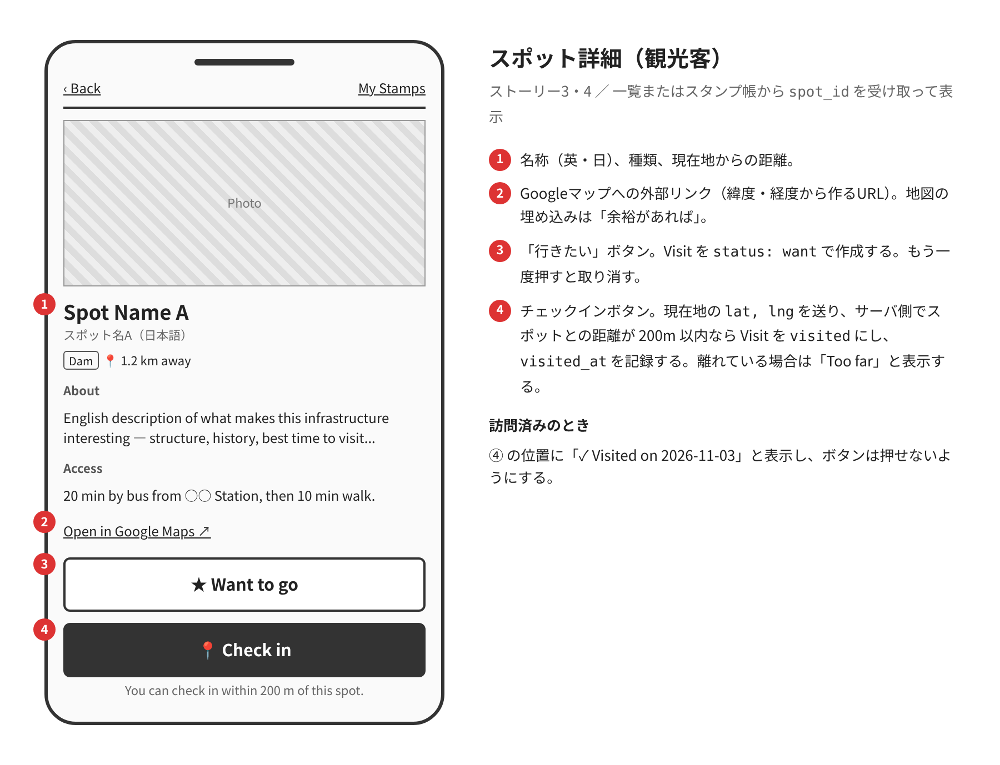
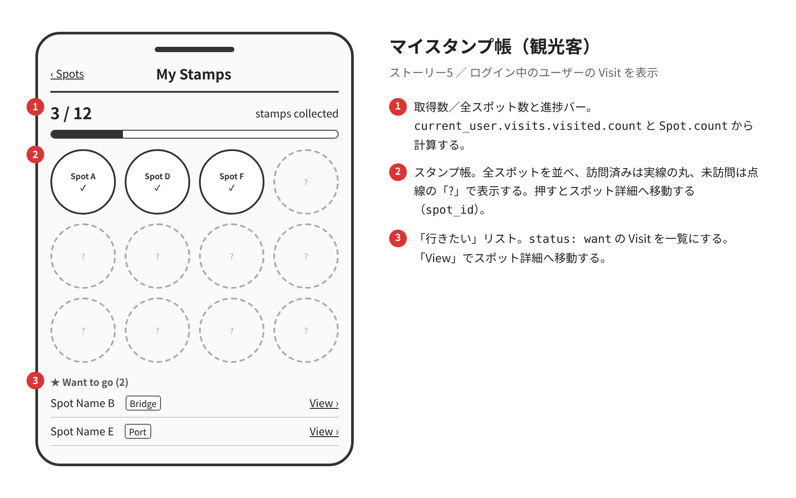
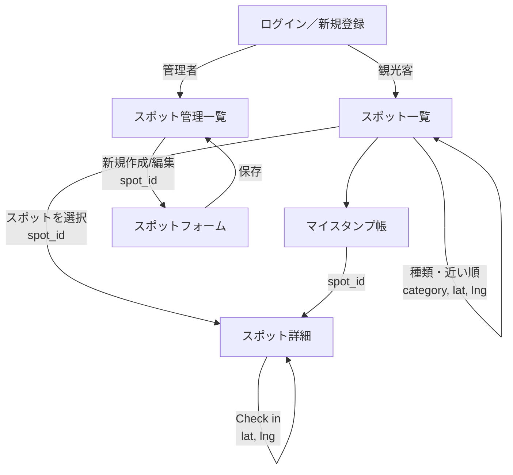
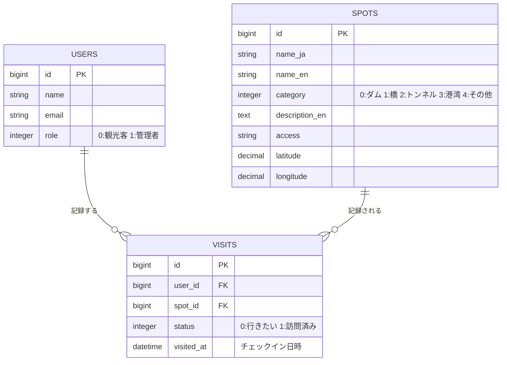

# SWEXE-Team4

# Deep Hiroshima Stamp Rally 基本設計書

- チーム番号：4
- メンバー：佐藤 寿樹／廣地　一鷹

---

## 課題

- **元になった自治体課題（COG2026）**：広島県「観光客が一部の有名観光地に偏っている／インフラツーリズム等の隠れた魅力が発信しきれていない」
- **選んだ課題**：宮島・原爆ドームを見終えた観光客が、ダムや橋などのマイナーな見どころに行きたくても、ガイドブックに載っておらず、どこへ行けばいいか分からない。
- **誰の課題か**：オーストラリアから来た20代のバックパッカー、サラさん。広島滞在2日目で、有名観光地は1日目に見終えた。
- **なぜこの課題を選んだか**：
  - 県は DoboX（広島県の土木インフラデータ基盤）などでデータや写真を公開しているが、「公開しているだけ」で観光客が実際に足を運ぶ仕組みになっていない。
  - 「行きたい → 訪問済み」というステータス管理で観光客の行動を後押しでき、さらに訪問の記録が県側の「どこに人が来ているか」というデータにもなる。両者の課題を1つの仕組みで扱える。
- **既存手段ではなぜダメか**：
  - Googleマップ：場所は分かるが、「インフラとして何が面白いか」の解説がなく、マイナースポットは検索の候補にも出てこない。
  - 県の公開データ：日本語の資料が中心で、観光客向けではない。訪問されたかどうかを県が知る手段もない。

## 0. 考えを整理する3つの問い

- **開発目的**：マイナーなインフラスポットを巡る「スタンプラリー」を提供し、有名観光地以外へ観光客を誘導する。あわせて、どのスポットに人が来ているかを県が把握できるようにする。
- **想定ユーザ**：観光客（サラさん）、管理者（県の観光担当者）
- **機能**：
  - スポットの登録・編集・削除（管理者）
  - スポットの一覧表示（種類別の絞り込み、現在地から近い順）と詳細表示（観光客）
  - 「行きたい」登録（観光客）
  - 現地でのチェックイン（スタンプ取得）（観光客）
  - マイスタンプ帳（観光客）
  - スポットごとの訪問数の確認（管理者）

## 1. ユーザーストーリー

- **ストーリー1**：【管理者】として、ガイドブックに載らない見どころを紹介するため、インフラスポット（名称・種類・解説・位置・アクセス）を登録・編集・削除したい。
- **ストーリー2**：【観光客】として、次にどこへ行くか決めるため、スポットを種類（ダム・橋・トンネルなど）で絞り込み、現在地から近い順に一覧で見たい。
- **ストーリー3**：【観光客】として、その日の予定を立てるため、気になるスポットを「行きたい」に登録したい。
- **ストーリー4**：【観光客】として、巡った証を残すため、現地で「チェックイン」ボタンを押してスタンプ（訪問済み）を得たい。ボタンはスポットの近く（200m以内）にいるときだけ押せる。
- **ストーリー5**：【観光客】として、達成感を得るため、マイスタンプ帳で集めたスタンプの数と「行きたい」リストを確認したい。
- **ストーリー6**：【管理者】として、発信の効果を確かめるため、スポットごとの「行きたい」数と訪問数を一覧で見たい。

## 2. 画面イメージ（ワイヤーフレーム）

観光客向けの画面は英語で表記する（サラさん向け）。管理者向けの画面は日本語で表記する。

| 画面 | 主な要素 | 対応ストーリー |
|---|---|---|
| ログイン／新規登録 | メールアドレス、パスワード | 全体 |
| スポット一覧（観光客） | 種類タブ、「近い順」ボタン、スポットカード（名称・種類・距離・スタンプ済みマーク） | 2 |
| スポット詳細（観光客） | 写真、解説、アクセス、地図リンク、「Want to go」ボタン、「Check in」ボタン | 3, 4 |
| マイスタンプ帳（観光客） | 取得数／全スポット数、スタンプ一覧、行きたいリスト | 5 |
| スポット管理一覧（管理者） | スポット一覧、行きたい数・訪問数の列、「新規作成」「編集」「削除」 | 1, 6 |
| スポットフォーム（管理者） | 名称（日・英）、種類、解説（英）、緯度・経度、アクセス | 1 |

## 3. ページ遷移図

## 4. データモデル（ER図）

### 関連付けと設計の理由

- `User has_many :visits` ／ `Visit belongs_to :user`
- `Spot has_many :visits` ／ `Visit belongs_to :spot`
- `User has_many :spots, through: :visits` で、観光客とスポットを**多対多**でつなぐ。中間テーブル `visits` が外部キー `user_id`・`spot_id` を持つ。
- 「未訪問」は Visit のレコードがない状態で表す。「行きたい」「訪問済み」は `status`（enum）で表す。こうすると、全スポット分のレコードを最初から作っておく必要がない。
- 1人が同じスポットに持てるレコードは1件だけにする（`user_id` と `spot_id` の組にユニーク制約）。「行きたい」から「訪問済み」への変更は、同じレコードを更新して行う。
- チェックイン時に、ブラウザの位置情報（Geolocation API）から得た緯度・経度とスポットの位置の距離をサーバ側で計算する。200m以内のときだけ `visited` に更新する（Visit モデルのバリデーション）。
- ストーリー6の行きたい数・訪問数は、Visit を `spot_id` と `status` で集計して表示する。そのためのカラムは持たない。
- スポットの初期データは、県の公開データ（DoboX等）を参考に、管理者画面または seeds.rb から登録する。

## 5. 開発着手の許可基準に対する自己チェック

- [ ] **課題の具体性**：広島県が実際に公開している課題をもとに、サラさんという1人の「2日目に行く場所がない」という場面に絞った。既存手段（Googleマップ・県の公開データ）では足りない点も説明できる。
- [ ] **連動性**：ストーリー1〜6のすべてが画面表と遷移図に対応している。画面上の項目はすべてER図のカラムか、Visit の集計で表せる。
- [ ] **ボリュームの妥当性**：モデル3つ、画面6枚、ステータス1種類（enum）に収めた。写真のアップロード（Active Storage）、英日の切り替え（i18n）、地図の埋め込み表示は「余裕があれば」とし、今回はやらない。

### 役割分担（案）

- 佐藤　寿樹：観光客側（ストーリー2〜5、位置情報によるチェックイン）
- 廣地　一鷹：管理者側（ストーリー1・6、初期データの登録）
- 認証（ログイン・role）は第9回に2人で一緒に作る。